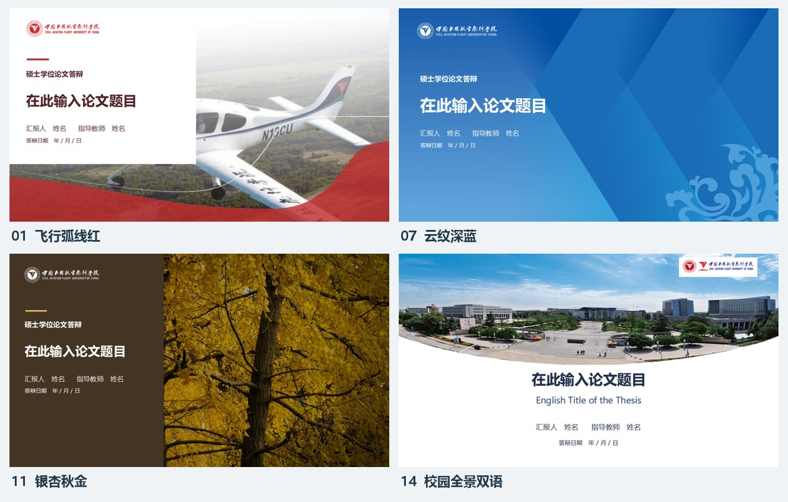

# 中飞院硕士论文答辩

面向中国民用航空飞行学院研究生的开题、阶段汇报与毕业答辩模板。14 款主题都可以直接用 PowerPoint 或 WPS 编辑。配套的 Codex 技能可以根据开题报告或论文编排幻灯片、撰写逐页讲稿，并核对校标与章节版式。

**[下载完整技能包](https://github.com/fenggezhang-pixel/cafuc-thesis-defense/releases/latest/download/cafuc-thesis-defense.zip)** · **[预览全部 14 款](assets/答辩主题选款.pdf)** · **[下载单主题包](https://github.com/fenggezhang-pixel/cafuc-thesis-defense/releases/latest)**

[](assets/答辩主题选款.pdf)

## 选一款模板

每款有 8 张示例页，依次为封面、目录、章节过渡、研究问题、技术路线、结果比较、工作计划和致谢。主题色也用于新插入的形状和图表。下表中的名称可直接打开对应的 PPTX，再点击 GitHub 的下载按钮保存文件。

| 想要的效果 | 可编辑模板 |
| --- | --- |
| 飞机照片配红、蓝弧线 | [01 飞行弧线红](assets/答辩主题/01_飞行弧线红.pptx) · [02 飞行弧线蓝](assets/答辩主题/02_飞行弧线蓝.pptx) |
| 航站建筑、礼堂线稿 | [03 航站青蓝](assets/答辩主题/03_航站青蓝.pptx) · [04 礼堂朱红](assets/答辩主题/04_礼堂朱红.pptx) |
| 图书馆建筑配渐变底色 | [05 暮紫图书馆](assets/答辩主题/05_暮紫图书馆.pptx) · [06 暖橙图书馆](assets/答辩主题/06_暖橙图书馆.pptx) |
| 深蓝云纹、暖色晨光 | [07 云纹深蓝](assets/答辩主题/07_云纹深蓝.pptx) · [08 晨光礼堂](assets/答辩主题/08_晨光礼堂.pptx) |
| 校园四季、飞行与夜景摄影 | [09 春绿校园](assets/答辩主题/09_春绿校园.pptx) · [10 晴空航迹](assets/答辩主题/10_晴空航迹.pptx) · [11 银杏秋金](assets/答辩主题/11_银杏秋金.pptx) · [12 校园夜景](assets/答辩主题/12_校园夜景.pptx) |
| 校园全景与学术汇报 | [13 校园全景中文](assets/答辩主题/13_校园全景中文.pptx) · [14 校园全景双语](assets/答辩主题/14_校园全景双语.pptx) |

中文全景款把研究目标与技术路线放在同一页，适合讲阶段进展。双语款为英文题名、目录和章节标题留出了独立位置。各款的封面、章节页和正文用标可在[主题索引](references/主题索引.md)中对照。

## 在 PowerPoint 或 WPS 中使用

1. 选定主题，将 PPTX 另存为自己的答辩文件。
2. 替换论文题名、作者、导师和日期。需要增加页面时，从“新建幻灯片”的版式菜单选取对应布局。要沿用结果表，可以直接复制示例页，在单元格里填入实际数据。
3. 校徽和中英文校名随版式继承。例如“礼堂朱红”在红底封面使用反白标，白底正文使用红标。需要更换时，在幻灯片母版中选中对应版式，等比替换[整组校标](assets/主题标识)。

## 在 Codex 中使用

解压完整技能包，将包含 `SKILL.md` 的 `cafuc-thesis-defense` 文件夹放进 Codex 技能目录。默认路径为 macOS / Linux 的 `~/.codex/skills/`，Windows 的 `%USERPROFILE%\.codex\skills\`。也可在首次安装时直接克隆仓库。

```sh
# macOS / Linux
git clone https://github.com/fenggezhang-pixel/cafuc-thesis-defense.git ~/.codex/skills/cafuc-thesis-defense
```

```powershell
# Windows PowerShell
git clone https://github.com/fenggezhang-pixel/cafuc-thesis-defense.git "$env:USERPROFILE\.codex\skills\cafuc-thesis-defense"
```

在新会话中附上自己的报告，输入类似下面的请求。

> 用 $cafuc-thesis-defense 把我的开题报告做成 12 分钟的答辩 PPT。选 07 云纹深蓝，按报告原表保留实验数值。每页配一份专家讲稿和一份口语讲稿。

## 检查成稿

在仓库根目录运行。校标检查脚本只需 Python 3 标准库。下面的例子核对 07 号主题的封面、章节页与正文用标。

```sh
python scripts/check_deck.py "assets/答辩主题/07_云纹深蓝.pptx" --theme 07
```

给成稿加上 `--dual-notes`，可以同时检查每页备注中的“【专家版】”和“【自用通俗版】”两种标记。需要为指定页添加可调透明度的图书馆底图时，先安装 `python-pptx`，再运行下列命令。

```sh
python -m pip install python-pptx
python scripts/add_library_watermark.py "答辩.pptx" "答辩_图书馆底图.pptx" --pages 3-6 --transparency 75
```

## 许可与素材来源

项目为学生整理的答辩工具。Python 脚本、技能说明和原创使用文档采用 [MIT 许可](LICENSE)。校徽、校名标准字、校园和飞机照片、参考母版美术素材的权利归各自权利人；涉及这些素材的再分发或商业使用，请另行核对授权。每款模板的参考文件见[素材来源索引](references/主题索引.md)。
